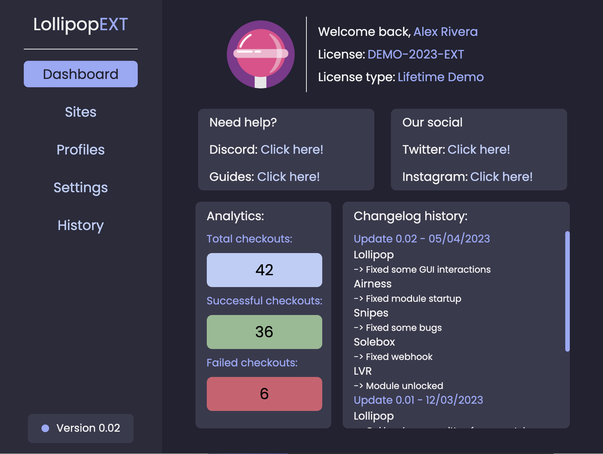

# LollipopEXT

A Chrome extension for managing checkout profiles and store workflows for Airness, Snipes, Solebox, and LuisaViaRoma. Built with JavaScript, HTML, CSS, and the Chrome Extension APIs (Manifest V3).



## Inside the extension

- Dashboard with checkout counts and history
- Saved profiles for checkout details
- Settings for each supported store
- Discord webhook fields for checkout notifications
- Background worker and content scripts for the store flows

## Try the interface

1. Open `chrome://extensions` in Chrome and turn on **Developer mode**.
2. Click **Load unpacked** and select this repository folder.
3. Open the extension and click **Login**.

The login loads sample profiles, checkout history, and statistics from [`js/demo-config.js`](js/demo-config.js). Store switches start **OFF**. This demo login does not validate a license.

To use your own Discord webhook, enter its URL in **Settings**. The URL is stored in Chrome's local extension storage and is not included in the repository.

## Screenshots

[Login](output/playwright/login.png) · [Dashboard](output/playwright/dashboard.png) · [Stores](output/playwright/sites.png) · [Profiles](output/playwright/profiles.png) · [History](output/playwright/history.png) · [Snipes](output/playwright/snipes.png)

## Code

```text
manifest.json   Extension manifest
html/           Popup and dashboard pages
css/            Styles
js/             Page scripts, demo data, background worker
modules/        Store content scripts
images/         Icons and UI assets
fonts/          Poppins font and license
```

Poppins is distributed under the [SIL Open Font License](fonts/OFL.txt).
